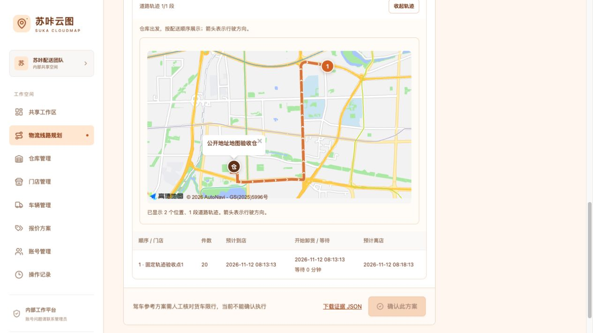
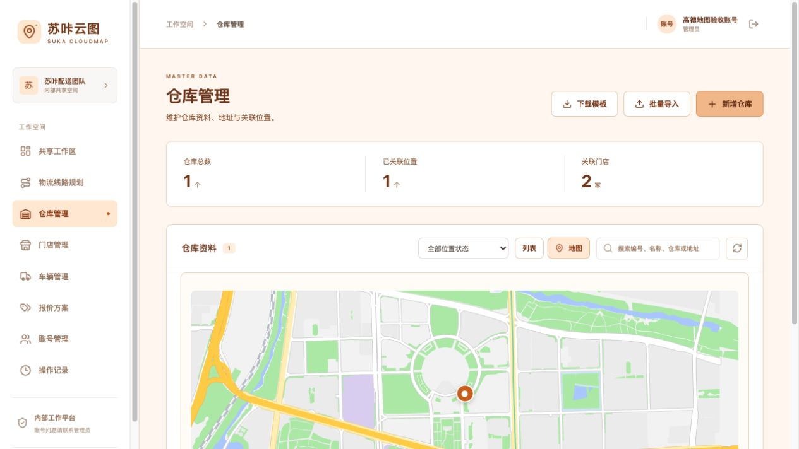

# 高德地图、驾车参考轨迹和车辆模板

v0.11.0，2026-11-12。本轮完成仓库/门店地图切换、逐车行驶轨迹、车辆导入下拉选项，并按用户要求用普通驾车接口生成参考草稿。

## 使用方法

1. 刷新[本地工作区](http://127.0.0.1:8000)。仓库/门店点「选择位置」，输入完整城市、道路、门牌或地点名称搜索，选中结果后保存；也可点击地图、拖拽标记或使用地图中心。新位置保存为GCJ02，并记录来源。切换「地图」可查看关联位置及标记详情。
2. 批量导入的仓库/门店经纬度留空时，后台使用高德地址解析及地点搜索。唯一精确匹配自动保存；只有城市/区县中心、同级多候选或服务失败时显示「需手动关联」，保留原因。此前失败的资料可筛选、勾选后点「重试未关联地址」。已有明确坐标保持原坐标系；WGS84/BD09仅在高德地图显示时转换。
3. 配送需求、当日资源和排线统一在「物流线路规划」。核对位置、车辆、报价和时间条件后冻结输入，在「方案规划与调整」填入「高德算路调用上限」再开始规划。初始上限为0；本机驾车模式单任务最多10次，重试也计入额度，缓存命中不扣额度。
4. 在专车卡片点击「查看行驶轨迹」，或进入「地图与行驶轨迹」筛选车辆。仓库标为「仓」，配送门店按顺序编号，路线按车着色并显示方向箭头。只绘制服务返回的道路折线；缺失路段明确提示，不以直线补齐。轨迹表示规划路线，不是车辆GPS历史轨迹。
5. 在车辆管理重新「下载模板」，点击数据行的「车型大小」「车辆类型」单元格可下拉选择。车辆大小为微型/轻型/中型/重型；类型为普通货车/纯电动货车/插电混动货车。可选范围覆盖第2至10001行；旧版数字编码继续兼容。模板也保留可用状态和牌照颜色下拉。参考文件：[新版车辆模板](车辆导入模板.xlsx)。

## 驾车参考与货车核验

普通驾车使用[高德路径规划2.0](https://lbs.amap.com/api/webservice/guide/api/newroute)的`/v5/direction/driving`，获取里程、当前交通参考耗时及道路折线。本地仍校验不拆票、车辆容量、同仓、报价兼容、经营时间和最晚到店；按规划发车时刻累加参考耗时，页面和Excel标为「预计到店/离店」。费用按冻结报价计算，不包含报价未定义的额外成本。

结果来源明确记为`DRIVING`，保存完整本地车辆/输入绑定及道路证据，页面显示「驾车参考费用」。它未核验货车限高、限重、限行、计划发车时刻或完整车牌约束，不能确认执行；前端按钮及后端独立复核均阻止确认。人工调整会保存新草稿，历史内容不被覆盖。指定时刻的预计到店和费用需要人工核对。

本次货车高级接口调用1次，返回10012（权限不足），按用户反馈停止付费接口复测，改测普通驾车。采用更保守的合并预算，货车与驾车总共记入4次尝试：货车1次、普通驾车2次网络失败（未收到HTTP响应）、1次成功，未超过10次。失败尝试也保留计数，见[调用账本](live-road-calls.json)。

真实驾车样例只使用两个公开地点及虚构测试车辆，不读取或发送业务车牌。成功返回7,646米、793秒、127个轨迹点；按5.8元/公里为44.35元。浏览器使用该真实响应生成独立测试草稿，只有一段公开地点线路，不代表多店真实配送的最终验收。原始公开坐标和折线见[驾车结果](live-driving-segment.json)，地址解析见[公开地址实测](live-geocoder.json)。测试用的另一版固定响应仅用于界面缺段验证，与真实轨迹分别标记。

## 配置和数据

三项密钥仅保存在本机忽略的`.env`，权限0600。`SUKA_MAP_PROVIDER=AMAP`；Web服务Key用于服务端地址解析和算路，JS公开Key由登录后的配置接口提供。JS安全密钥通过同源`/_AMapService`限定路径代理使用，不返回到浏览器，不允许利用代理调用算路或搜索接口。地图SDK按[高德安全代理说明](https://lbs.amap.com/api/javascript-api-v2/guide/abc/jscode)配置；AMAP模式CSP允许其指定域名及SDK渲染所需eval，OPEN模式保留原策略。

本机配置`SUKA_PLANNING_ROUTE_MODE=DRIVING`、`SUKA_DRIVING_LIVE_CALLS_ENABLED=true`、`SUKA_DRIVING_JOB_MAX_CALLS=10`，货车收费开关关闭。样例配置默认关闭全部外部算路；切回TRUCK需配置对应权限并完成独立验收。接口缓存将来源、车辆全参数、顺序、坐标、计划时刻和策略共同绑定，驾车与货车不混用证据。

原业务8000、隔离试用8001沿用各自数据库和已有账号。8001继续使用TEST_GRID模拟道路，真实算路关闭，地图使用高德；只能演练，不能执行。两库已创建私有且完整性校验通过的备份，见[备份记录](backups.json)。本轮没有新增数据库迁移，仍为`0005_location_tasks`。

## 验证

后端全量1345项通过，前端28项通过，TypeScript及生产构建通过。新增55项后端回归覆盖高德匹配/精度/歧义/异常/缓存、队列GCJ02保存、代理权限及凭证隔离、模板中文与旧数字转换、驾车错误及调用预算、容量/同仓/报价/时间冲突、真实工作队列、参考证据不能确认和导出标签。

浏览器在独立测试库完成真实高德底图、地址搜索并保存、拖拽标记后保存、专车内嵌轨迹/单车筛选/仓库标记及方向箭头、确认禁用，以及实际模板下载；下载文件的下拉验证见[模板检查](template-download-check.json)。浏览器位置修改仅发生在一次性测试库。完整记录见[validation.json](validation.json)。

尚待人工复核真实门店位置/收货限制、实车证件参数及业务拼车单价；正式环境、PostgreSQL和真实货车通行验收仍需后续完成。历史收入没有自动作为拼车成本。
