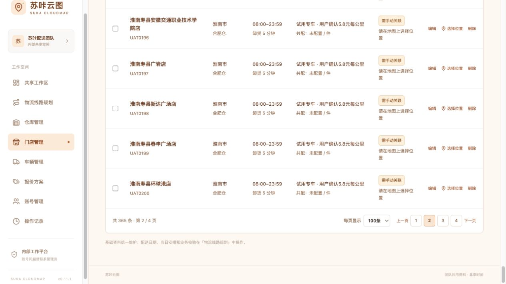
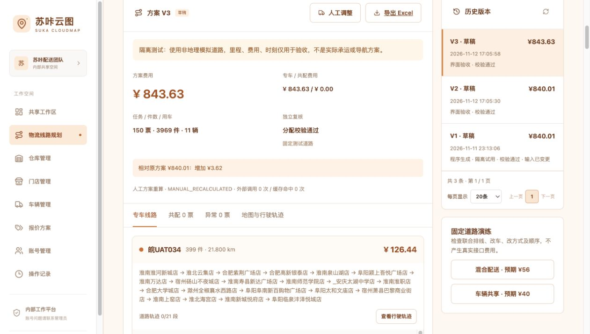

# 需求分组、报价及测试使用说明

## 0.15.0 日常深度规划（2026-11-13）

完整流程已接入日常「开始规划」，新建需求分组即可使用：选择配送日期和分组，创建或导入需求，核对仓库、车辆、门店时间及报价并冻结输入，然后点击「开始规划」。默认优化计算时限为300秒，可在1至24000秒内调整；页面会显示阶段、轮次、种子、保留候选数及当前最低候选费用。道路排队与网络等待另计，并受整体等待上限约束。

每个任务自动执行多轮、多种子和多策略搜索，汇总本任务中各轮的线路候选及完整方案，再按当前冻结输入重新报价，用CP-SAT联合选择专车、共配及物理车辆分配。计费使用真实报价及整数分金额，检查同仓、报价兼容、车辆可用性和容量、门店整票不拆分、营业及最晚到店时间。常规候选最多保留10000条并记录截断情况，各轮完整方案另行保留，不能用未经完整复核的候选低价覆盖已验证方案。新分组不自动继承其他分组的配送安排或费用。

日常真实算路入口会自动复核最终候选道路，无需另选刷新开关。先采集本轮高德道路，再固定已取得的真实回执；出现时窗冲突时，比较重排、共配和可用车辆等修复，并只为新连接路段补采数据。其他有降费潜力的完整轮次方案也会在剩余时限内比较，之后再次联合选优。已取得的同向同坐标路段在本任务内不反复重刷，避免交通响应变化让验证不断循环。最终保存本次找到且通过完整复核的最低费用可行草稿，保留实际采集时间、调用次数和证据；不会把历史时长或旧低价伪装成本轮实时结果。

高德服务继续使用共享每秒3次限流，不设原先10次的任务总调用上限；搜索和复核仍受用户设置的计算时限、整体等待时间及候选范围限制。取消时只保留已有完整合法方案；未完成、金额不完整或证据不符的结果不追加新草稿。输入或当前方案在运行中被他人修改时，保存会拒绝覆盖，原输入与历史方案保留。关闭真实调用的隔离入口明确标记为已有道路参考，固定样例也不会标记成实时高德复核。普通驾车数据仍不构成货车限行或未来发车路况证明。

本轮以主库和道路图的私有副本进行真实HTTP验收：重新创建需求组，225店、4378件，自动执行5个不同种子，保留10000条候选；实际调用高德180次，最终选择其中155段道路，得到23882.15元完整可行方案。测试组没有继承test2的既有方案，没有写入主库需求或方案，原test2 V5及23595.33元历史报价保持原样。本轮结果验证日常自动流程，不能将不同输入、时限和道路批次的金额当成全局最优保证，也不表示每次点击都会重复0.14的103轮长时间研究。实际记录见 [新分组日常流程验收](../data/daily-deep-20261113/real-new-group-300s/acceptance.json)。

后端干净全量2321项、前端115项通过，TypeScript检查与生产构建通过；发布保护另26项专项通过，分别记录，不相加成唯一用例数。有限候选池的最优证明只覆盖该池中已保留、已重新计价的线路，不代表全部可能线路的全局最低。

发布后已在Chrome实际点击「开始规划」，用独立副本中的15秒短任务核对按钮、四轮进度、自动道路复核、冲突修复及新版本保存。共155次真实道路调用，最终154段专车道路；保留原验收V6并新增V7，界面如实显示最新报价与原报价的差额。默认300秒完整验收仍以上述新分组记录为准。高德底图、淮安仓出发的专车轨迹及放大、缩小、全屏均通过。五个受管入口已重启；发布后及浏览器验收后逐行核对四库104表，新增、修改、删除均为0，原账号密码及test2 V5保持不变。详见 [最终验收记录](../data/daily-deep-20261113/validation-final.json)、[规划页面](../data/daily-deep-20261113/browser-acceptance/daily-deep-complete.png)及[专车轨迹](../data/daily-deep-20261113/browser-acceptance/gaode-dedicated-trajectory-fullscreen.png)。

当前外网测试地址保存在 `data/external-test/current.json`。发布重启或重建隧道后地址可能变化，请使用文件或启动终端中的最新地址，文档不固定旧临时网址。

## 0.14.0 算法研究及历史草稿

以下为0.14.0的研究、测试及V5历史记录；当前日常一键流程以本页0.15.0说明为准。

0.14.0算法改造与验收（2026-11-13）：以全部配送完成后总支出最低为首要目标，费用相同时再比较专车里程及车辆数。装载率作为结果指标显示；报价没有固定出车费时，更多车辆、较低装载率也可能降低总费用，不以装载率替代成本目标。

自动规划联合比较旧版候选生成器、[OR-Tools引导局部搜索／模拟退火／禁忌搜索](https://developers.google.com/optimization/routing/routing_options)、[自适应大邻域搜索](https://backend.orbit.dtu.dk/ws/files/3154899/An%20adaptive%20large%20neighborhood%20search%20heuristic%20for%20the%20pickup%20and%20delivery%20problem%20with%20time%20windows_TechRep_ropke_pisinger.pdf)及混合搜索。共配费用用于权衡放弃专车访问的代价，候选池最终用整数金额核算实际报价及物理车辆占用，避免把搜索权重当成实际费用。所有结果再通过独立分配、容量、时间及报价校验。大规模限时结果只称已验证最佳方案；候选池内最优、松弛下界及小规模穷举证明分别记录，不能替代全局最优证明。

驾车道路搜索可使用7日内的历史实路参考，保留最初接收时间及来源证据，不将旧道路伪装为实时请求。自动规划可选择刷新道路；人工核算可要求刷新最新选中线路并重新报价。刷新道路失败时不沿用旧低价冒充新报价。每秒3次共享限流继续生效，排队和网络时间单独统计；优化计算时间及额外道路等待均有上限，支持中止并保留已验证完整方案。

本轮经用户确认，将AH0188「淮安万达店」从合肥仓调整为淮安仓，并同步门店资料。随后保留用户对AH0255「淮南拓基广场店」城市及行政区资料的修改，追加输入快照V4。原有快照及方案保留，算法公平对照使用调整前冻结输入，资料变化单独记录。

最终保存位置：物流线路规划，选择2026-11-12、分组test2、草稿V5。225店、4378件全部分配；17辆专车配送165店，60店共配。专车17497.03元、共配6098.30元，合计23595.33元；原V4为30575.37元，减少6980.04元（22.83%）。这项对比包含仓库归属、城市资料及道路重算变化，页面会提示输入发生变化。按现有报价、不计返仓路段、一辆物理车辆一条线路及门店整票不拆分的业务规则核算。

正式对照共103轮，使用同一冻结输入和26883条完整实测道路参考，按60秒初筛、300秒复筛及优胜方法1800秒长测分层；各阶段记录相同预算的比较，后续加测不冒充所有方法总预算相同。原输入的最低实测费用24883.77元，比原方案减少5691.60元。归仓后的多种子搜索、真实API工作流验收及跨轮线路组合另行记录。有限候选池整数求解曾得到23278.47元，但最新道路时长使其部分线路迟到，因此未保存该低价。

三轮刷新共实际调用501次高德驾车接口，接口失败0次。对到店时间变化逐次修复后，最终从第三轮166条真实回执中保留165条行驶路段，末店改为共配，没有新增接口调用，也没有改写采集时间。最终报价通过容量、门店覆盖、到店时间、共配金额、逐段道路回执及独立报价复核；所有旧候选池最优证明已清除。23595.33元是本轮最终验证可行方案，225店全局最优仍未证明，普通驾车道路也不构成货车限行或未来路况证明。

历史回放覆盖7个配送日，小规模独立穷举对照及当前资料重放均有单独记录；费用使用当前报价，未把历史收入当作承运成本。默认采用混合搜索，保留更便宜的完整历史方案；每次原生搜索采用短切片。较长纯禁忌搜索观察到较高内存使用，因此没有设为默认。最长单次实测1800秒，不把它描述成24000秒稳定性实测。新需求可按规模增加优化时限，并随时取消、保留已验证方案。

完整后端2086项、前端107项通过，另有道路刷新、最新输入、整数选择、备份及服务恢复专项测试，重复执行的测试组不合计成唯一用例数。四个业务数据库在追加前完成一致性备份；追加后逐行核对所有旧记录，仅新增一个草稿及两条对应审计。完整实验、输入版本、费用归因、实测资源和来源SHA见 [综合验收记录](../data/algorithm-lab-20261113/final-study-report.json)。

发布后Chrome在业务数据库的隔离副本确认V5金额、输入变化提示、旧版本及采集时间。高德底图加载成功，淮安仓与淮安万达店首站显示正确，苏A5XB58的14段道路轨迹、放大缩小、全屏进入和退出均通过。验收没有创建主库账号或启动新的规划任务；四库104表的旧记录在浏览器验收后再次核对通过。见 [V5费用截图](../data/algorithm-lab-20261113/release-ui-private/final-plan.png) 和 [淮安线路全屏截图](../data/algorithm-lab-20261113/release-ui-private/final-map-fullscreen.png)。

0.13.0增补（2026-11-12）：特殊地区附加费新增「每家命中门店分别收取」，与「整条线路一次性」「每个送达区县一次性」并列。按公里与起送加串店两类地区报价均支持。同一区县多店在按店模式分别计费；城市与区县重叠时同店只计一次。缺省旧报价仍按整线一次收费，旧版本不改写。

共配只核算件数与共配单价，不安排或校验到店、营业、卸货及最晚到店时间。专车继续遵守全部时间限制。历史共配原因中的时间冲突仅是原专车候选说明，页面已明确标注，历史证据保留。

自动规划升级为多起点线路生成、物理车辆组合选择、拆线增车与跨车迁移，以完整分配优先、总费用最低为目标。可比较同时替换多条线路的方案，车辆更多但总费用更低时会采用。候选组合使用 [SciPy MILP/HiGHS](https://docs.scipy.org/doc/scipy/reference/generated/scipy.optimize.milp.html)；限时保留已验证最佳方案并支持取消。页面区分候选池内最优与全局最优，尚未考察的线路不作最低费用保证。同快照重算显示原报价、新报价及差额。

普通驾车仅发送坐标和策略，同向同坐标的有效参考路段可跨车辆和发车时刻复用，重新绑定当前输入及证据哈希；原接收时间保留，过期缓存仅作搜索提示，必须重算核验。货车专用道路证据不采用这种复用。每秒3次共享限流及真实地图轨迹保持。

test2真实验收：225票、4378件、21辆可用车。刷新76个高德普通驾车路段后，新算法自动把4辆专车＋166票共配的31720.97元，优化为5辆专车＋153票共配的30575.37元，减少1145.60元，未分配0票。专车增加1199.40元，共配减少2345元。该结果为普通驾车参考，未证明全局最优，不能作为已核验货车执行方案。原V3和冻结快照保留，新增草稿供人工检查。完整记录见`test2-improvement-20261112`。 本轮后端整套1546项通过，随后新增3项边界回归均通过（共1549项）；前端82项、TypeScript及生产构建通过。浏览器在发布后数据副本确认V4费用对比、共配无需校验和新增专车14段实路轨迹。四个数据库原账号、资料、需求、快照及历史方案内容逐行保持一致。

0.12.0增补（2026-11-12）：特殊地区报价支持勾选多个城市或区县，并选择整线一次性附加费或按每个实际命中区县收费。同区县多门店、城市与区县范围重叠均不重复计费；跨城市同名区县分别计算，资料不足时费用待核对。旧报价缺省继续按整线一次收费，不改写旧版本。

所有批量选择表头新增「全选所有」，跨全部页合并当前筛选结果，保留已选的其他资料；批量操作最多10000条。分页统一默认10条，可选10、20、50、100，账号与操作记录也已分页。

优化时限上限提高至24000秒，可取消；任务以短租约心跳续期，进程中断后不需等待完整时限才恢复。人工配送方式新增「专车（自动分车排线）」，按货量、仓库、报价兼容、容量、营业时间及道路条件分配车辆和顺序，保留人工指定车辆、共配及未分配选择。无可行专车时保留异常，不自动转共配；最新费用与原费用一并对比。小规模枚举，大规模限时搜索，页面说明是否已证明最优。

修复初次载入方案时，迟到请求可能覆盖刚切换的固定样例或未保存人工选择的问题。最终后端1514项、前端79项通过，另有41个独立穷举场景对照；浏览器复验多区县报价保存、自动专车、24000秒输入、费用对比及快速切换。验证记录见`features-v2-20261112`。

2026-11-12功能增补：每日业务改为先选择需求分组。可在同一天创建多个分组，在组内人工新增、修改件数、移除需求或批量导入；导入只替换本组。门店报价校验、仓车安排、收货限制、快照、规划任务及方案历史均隔离到分组。删除分组会原子清理该组导入、需求、安排、快照、任务和方案；运行中的任务不能重新写回已删除内容。其他分组及四类基础资料保留。

既有各日期的业务升级为「历史需求」组，原账号密码、门店和车辆资料、输入快照及方案JSON和哈希均保留。首次继续旧方案排线时，若提示输入已变化，请重新冻结输入后生成当前分组方案。版本号为同日全局连续编号，各组列表和当前版本分别维护。

人工调整中新增「是否优化线路」：不优化时严格使用人工顺序；优化时保留配送方式及车辆安排，以线路费用为目标调整顺序，并显示是否已证明最优。8店以内穷举，大线路在时限/候选数内搜索。每次核算重算报价，显示原费用、最新费用和差额。普通驾车仍为参考道路，不提供货车执行确认。

基础管理新增两种特殊地区附加费报价（按公里／起送加串店，各加一次性地区费）；按省、市、区县逐级选择，任一目标命中整条线路只收一次，重叠地区不重复加收。区县不足以判断时费用待定并提示补齐，避免按0元漏算。门店可按省市区筛选，跨页批选修改仓库、营业开闭时间、跨日、卸货时长、专车报价及共配单价；支持所选门店XLSX导出。批改和导出均核对修订号，过期时整批拒绝。

所有位置及线路地图都有放大、缩小和全屏；不支持原生全屏的浏览器使用页面展开，Escape退出。账号管理提供删除，撤销原会话、从列表移除并保留其历史记录；保护当前账号及最后一位管理员。共享记录选择任务日期，管理员可完成或恢复待办，完成内容归入「已完成任务」，超过北京时间任务日仍未完成则进入「已超时」。

最新功能验收：后端1451项、前端65项通过，TypeScript检查及生产构建通过。四个数据库已备份并升级至0006_group_workflows，所有旧表旧字段内容、账号密码及快照/方案JSON和哈希保持一致。浏览器实测新建组、人工创建需求和自动快照，以及区县附加费报价保存。完整记录见`features-20261112`；此前分页、地图恢复及名称修复继续保留。

## 业务使用

- 基础管理、每日需求、来源行、快照明细/历史、规划门店、人工调整、共配、异常、方案历史及共享记录统一显示当前页、总页数和页码按钮。默认每页10条，可选10、20、50、100条，切换条数回到首页；已有跨页勾选和人工安排保留。
- 进入「物流线路规划 → 方案规划与调整 → 人工调整」，完成配送方式、车辆和顺序选择后点击「开始核算」。按人工选择计算里程、到店时间、费用和冲突，保存新版本并显示相对原方案的费用差额。失败或版本冲突时保留未保存选择，核算期间支持取消。
- 高德算路不再限制总次数，每秒3次共享限流继续生效。优化时限仍可设置，普通驾车参考仍需人工核对货车限行。
- 当天最晚到店默认取门店闭店时间，按配送日期和次日闭店标记生成完整北京时间。特殊当日限制保留，清空后恢复跟随闭店。历史快照不改写，输入变化后需重新冻结。

## 另一台电脑从外网测试

当前临时地址由本机`data/external-test/current.json`记录，已在聊天中提供可点击链接。使用现有账号密码，访问同一份业务数据库；没有创建默认账号或更改原密码。

本机需保持开机、联网且不休眠，并运行测试进程。停止进程后网址失效；重新启动通常会获得新网址。可双击项目根目录的「启动临时外网测试.command」重开，终端显示HTTPS地址；双击「停止临时外网测试.command」关闭。已有入口运行时会显示现有地址，不重复启动。

2026-11-12更新后恢复：原有本地进程和隧道已退出，已重新启动。上述`.command`入口改用独立进程会话，关闭启动终端或聊天窗口后仍可运行。电脑重启、注销或进程退出后，可双击「恢复全部测试入口.command」恢复本地、隔离测试、两份验收归档及临时外网；「停止全部测试入口.command」关闭这些后台进程。没有配置开机自启或自动重启。运行记录和私有日志位于`data/managed-services`，外网最新地址仍以`data/external-test/current.json`为准。

本次逐一验证了四个本地入口及外网的健康检查、登录页和前端资源；未登录业务接口仍返回401。浏览器已打开新的外网登录页。恢复前后的账号和九类业务表内容一致，备份及验证记录位于`data/service-recovery-20261112`；检查没有调用真实高德算路。

独立入口仅监听127.0.0.1:8770，由Cloudflare Quick Tunnel提供公网HTTPS；严格绑定生成的域名、启用Secure/HttpOnly Cookie和独立会话名称。业务、地图配置和地图代理均要求登录。现有8000本地、8001试用和8765/8766归档入口保留。

Cloudflared二进制只安装在项目`.cache`，来自Cloudflare官方GitHub发布并核对SHA256；没有改路由器端口映射或防火墙设置。[官方Quick Tunnel说明](https://developers.cloudflare.com/tunnel/get-started/quick-tunnels/)说明该入口用于测试、地址会变化且进程停止后失效。

## 验收记录

2026-11-12地图加载恢复：同一套凭据在检查中出现两次25秒连接超时，随后在线脚本和真实底图恢复；未观察到Key失效错误。SDK等待从20秒调整为45秒，首次失败后间隔1秒自动重试一次；两个尝试都失败才显示可人工重载的具体错误。并发地图共享一次加载，半初始化的SDK不再被当作已就绪，超时请求的迟到回调不会干扰下一次重试。底图加载等待同步放宽至45秒。前端50项测试及生产构建通过，未更换Key、未调整QPS、未重启外网隧道。四个本地入口及外网均已提供新资源，地图代理未登录仍返回401。使用[高德官方在线加载方式](https://lbs.amap.com/api/javascript-api-v2/guide/abc/load)，安全密钥继续通过同源代理留在服务端。详细记录见`retest-20261112/map-recovery`。

浏览器在隔离库验证365家门店：每页100条时第二页显示100条记录，页码为2/4；在150票3969件固定路网方案中调整顺序并核算，保存V3，费用从840.01元变为843.63元，差额3.62元，分配校验通过。金额仅是固定路网测试结果，外部算路调用为0。

新增测试验证普通驾车适配器可超过10次调用，并继续遵守限流、缓存、取消及有限重试；临时HTTPS应用验证Secure Cookie、Host和Origin限制。公网验证登录页200、未登录业务/地图接口401、非信任来源写入403。

机器可读记录及日志见`docs/retest-20261112/latest-validation.json`。界面证据：

