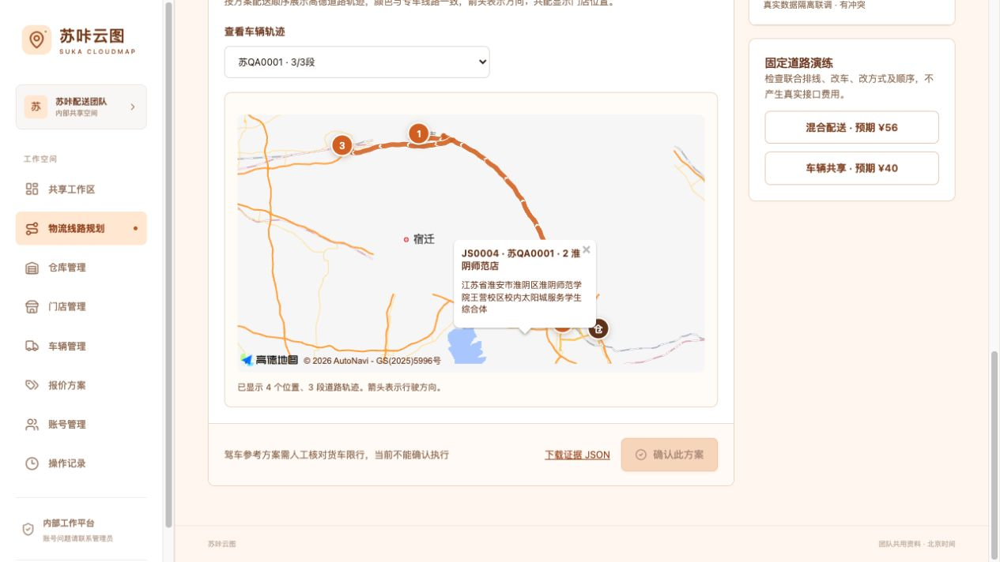
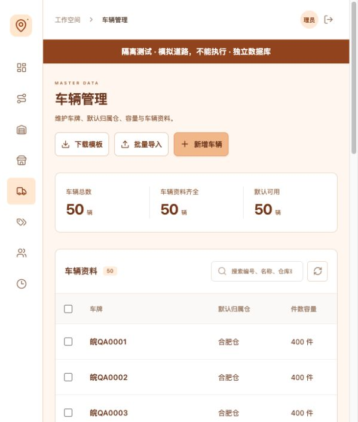

# 真实配送全量回放与位置重关联验收

v0.11.1，2026-11-12。本轮在业务库重试失败位置，其他导入、规划、改序和轨迹验证均使用独立测试库。原始Excel文件未修改。

## 位置重关联

开始时业务库有377家门店，其中73家已有位置、304家待处理；两个仓库均已有位置。经过分批诊断和重试，新增关联115家，目前188家已有位置、189家仍标记「需手动关联」。原73家已有坐标、仓库资料、21辆业务车辆、报价、账号和业务需求均保留。具体数量、失败原因及逐表保留检查见 [location-result.json](location-result.json)。

剩余记录区分「未找到精确地址」「多个候选」「该地点检索范围受限」，不会把这些情况统一伪装为成功。业务端可在门店管理选择「需手动关联」筛选，按地址搜索、点击或拖拽地图校正后保存。完整地址和原因清单保存在本机私有目录 `data/retest-20261112/manual-locations.csv`。

本轮修复以下实际问题：

- 高德30001属于引擎响应失败，原先被当成Key权限错误，导致后续整批地址中断。现在可回退地点检索，单地址问题不影响后续记录。
- 地址完全一致的住宅区，以及名称、城市和区县均严格一致的POI，原先可能被排除。现在接受这类唯一结果；同级多候选、门牌冲突、楼层无法对应等情况仍需人工确认。
- 高德10045只在部分检索触发，而公开国内POI仍返回正常。现在区分海外范围限制与普通国内服务配额；单地址限制不暂停其他国内检索。地点搜索不可用时保留地址解析候选，真正的整体配额限制只暂停对应检索能力，不清空可用地址结果。诊断见 [geocoder-probe.json](geocoder-probe.json)、[poi-scope-check.json](poi-scope-check.json)。错误码分类依据[高德官方说明](https://lbs.amap.com/api/webservice/guide/tools/info)。
- 原合肥仓的WGS84位置可以显示在地图上，但普通驾车算路曾直接拒绝。现在驾车参考请求显式换算声明过的WGS84/BD09，记录原坐标、转换后的GCJ02坐标及转换方法，并独立复核转换记录；原资料不被改写。使用与界面相同的coordtransform算法，属于参考转换，不证明入口位置或货车通行能力。货车接口的严格GCJ02要求保持独立。
- 日期输入在异步等待离开确认时可能回跳。无未保存修改时同步更新日期，有修改时仍通过应用内窗口确认，取消会保留原日期和人工选择。组件与浏览器已验证原生日历、数字输入、取消切换和继续编辑。

按本轮控制台截图增加共享QPS限流：地理编码、关键词搜索、驾车规划各最多3次/秒，地图认证代理最多10次/秒；各服务单独平滑排队并留20毫秒间隔余量。所有本机进程及不同业务库共用一个独立限流文件，只保存服务名称和下次允许时间，不保存Key、地址或月调用量。没有新增月配额检查。

高德10014、10015、10019、10020、10021、10029或HTTP 429触发短时退避，等待也在不同进程间共享。地址请求最多3次，算路最多2次且每次均计入任务原调用预算。地址持续超限只标记当前记录稍后重试，不再按权限错误停止整批。缓存命中不占外部请求，排队可取消；存储异常时不会绕过限流。多进程及模拟超限测试不调用真实道路接口。上限以用户截图为准，[高德流量限制说明](https://lbs.amap.com/api/webservice/guide/tools/flowlevel)也要求从控制台查看具体QPS。

## 全部真实配送数据回放

来源是物流分析文件夹中的5份原始登记表：6、7、8、9、10月份。读取登记表的真实日期行，排除公式尾行和辅助工作表。共150个配送日、12,185条有效来源行、408个门店名称、241,806件；2条零件数记录保留在来源批次，不创建配送任务，最终验证12,183票任务。

按用户本轮确认，原未确认归仓的264行（商丘81、临沂70、周口42、未填城市71）全部归合肥仓参与测试，在隔离库补建43家历史门店。该规则没有写回业务库归仓，也没有改原始Excel。见 [all-source-scope.json](all-source-scope.json)。

每个配送日完成输入快照、联合规划、逐票独立复核和Excel导出核对；检查不拆票、任务不重复、不漏票、车辆不复用、每车最多400件、同仓、报价兼容、时序和十进制费用。另验证人工反序、历史恢复、测试方案不能确认，以及8名并发用户的320次读取，无HTTP 5xx，读取P95为1.7429秒。完整记录见 [historical-replay-all.json](historical-replay-all.json)。

这150日使用明确标识的非地理TEST_GRID固定路网，验证完整业务流程和约束。历史试用配置采用5.8元/公里、50辆参考车辆，以及测试营业/卸货时间；模拟里程与费用不是历史真实承运成本，也不证明实际道路最优。历史收入没有自动写为未来共配单价。原表支出仍按此前确认的「日期＋车牌取来源首行」规则独立处理。

## 真实三店专车轨迹

另选2026-10-31的3家已定位江苏门店、56件真实需求，使用当前业务仓库位置和收货条件，以及虚构测试车辆苏QA0001，验证普通驾车接口。未把历史真实车牌发给高德。

| 验证顺序 | 道路段数 | 返回米数 | 按5.8元/公里计算的参考费用 |
| --- | ---: | ---: | ---: |
| 第一组人工顺序 | 3 | 410826 | 2382.79元 |
| 反序 | 3 | 441542 | 2560.94元 |

6段接口均成功，共6388个折线点；两组费用相差178.15元。顺序是用于验证的人工选择，没有声称是最优路线。报价在隔离库回溯至样例配送日，未更改业务报价生效日。耗时使用本次接口返回的交通参考值，不是2026-10-31当天的实测交通或到店记录。

通过真实HTTP和浏览器再次完成改序重算、费用差额、历史恢复、单车筛选、仓库/配送序号和方向箭头显示。重算命中3段缓存，外部调用为0。真实轨迹版本保留V1至V5，原证据不被覆盖。JSON记录见 [real-driving-test.json](real-driving-test.json)、[real-route-http.json](real-route-http.json)。

本轮自动联调新增6次驾车调用，与上轮保守计数合并为10次，后续不再调用道路接口。账本见 [live-road-calls.json](live-road-calls.json)。仅普通驾车参考，尚未验证货车限高、限重、限行和指定发车时刻，前后端均阻止专车方案确认执行。

## 车辆批量导入

使用实际xlsx文件上传50辆参考车辆，容量均为400件，覆盖3种中文车辆类型。包含错误车型的文件正确定位到第3行，整批提交被拦截；修正后整批通过，重复导入保持50辆、不增加重复记录。新模板中的车型大小、车辆类型均有可选项，旧数字编码继续兼容。

浏览器完成文件选择、错误预览、有效预览与确认导入。测试车辆和原21辆业务车辆分别存放；未把测试车写入业务库。

## 人工复查入口

业务应用仍为 [8000工作区](http://127.0.0.1:8000)，刷新页面即可使用修复。原 [8001试用库](http://127.0.0.1:8001)保留。

本轮两份验收库已另行归档，使用原有账号密码登录；临时QA账号均已停用、会话已清理。复查时可双击项目根目录的：

- `启动本轮完整验收.command`：访问 `http://127.0.0.1:8765`，查看包含264行新归仓口径的150日完整回放；默认日期2026-08-06，使用固定测试路网。
- `查看真实轨迹验收.command`：访问 `http://127.0.0.1:8766`，在物流线路规划选择2026-10-31，查看真实三店参考轨迹及历史版本。

也可执行 `.venv/bin/python scripts/start-acceptance.py --mode history` 或 `--mode driving`。两个入口均只监听本机，自动定位与真实算路关闭；历史轨迹无需重新调用接口即可查看。缓存到期或尝试新路段时，关闭外部调用的验收入口不会偷偷发起新请求。

## 验证结论

后端1397项、前端32项通过，TypeScript与生产构建通过。新增后端回归覆盖错误分类、单条失败隔离、POI降级/缓存、海外范围不影响国内检索、精确住宅区/POI匹配、原坐标保留及转换证据复核；其中30项专项覆盖共享QPS、多进程、各接口独立排队、超限退避、重试预算、取消与异常保护。前端增加日期同步/取消保护、转换说明及检索受限候选保留测试。

原始文件SHA256、备份、账号/资料保留、运行状态和凭证扫描统一见 [validation.json](validation.json)。数据备份记录见 [business-backups.json](business-backups.json)。验收只覆盖本机SQLite及上述固定路网/普通驾车参考场景；真实货车通行能力和正式部署环境验收仍需后续完成。
